<div align="center">



[](https://siddhant-pardeshi.github.io/)
[](https://siddhant-pardeshi.github.io/recruiter.html)
[](#-testing--quality)
[](#-tech-stack--architecture)

**A portfolio that plays back.** Every architecture decision on this site can be *watched, touched, and heard* —
walk a bank transfer through its transaction pipeline, aim a webcam and swing particles with your bare hand,
and get guided by **Byte**, a capybara with 12 emotions who dances if you find his secret combo.

`Java` `Spring Boot` `MySQL` `React` `REST APIs` `Vanilla JS` `GitHub Pages` `Zero dependencies`

[🚀 Live experience](https://siddhant-pardeshi.github.io/) · [🎯 Recruiter view](https://siddhant-pardeshi.github.io/recruiter.html) · [🦫 Meet Byte](#-byte-the-capybara-who-reacts-back) · [✋ Hand control](#-hand-control--your-webcam-is-the-controller) · [▶ Play the sims](#-playable-backend--watch-the-code-think)

</div>

---

## 📖 Table of contents

- [What is this?](#-what-is-this)
- [Why it's different](#-why-its-different)
- [🦫 Byte — the capybara who reacts back](#-byte-the-capybara-who-reacts-back)
- [✋ Hand control — your webcam is the controller](#-hand-control--your-webcam-is-the-controller)
- [▶ Playable backend — watch the code think](#-playable-backend--watch-the-code-think)
- [🔊 Sound design — the site has a voice](#-sound-design--the-site-has-a-voice)
- [📸 The photo wall & hero polaroids](#-the-photo-wall--hero-polaroids)
- [🎯 Recruiter view — a 60-second hire decision](#-recruiter-view--a-60-second-hire-decision)
- [🎛 Command palette, tour & settings](#-command-palette-tour--settings)
- [🧱 More builds — the open-source shelf](#-more-builds--the-open-source-shelf)
- [🎨 Design system](#-design-system)
- [🧪 Testing & quality](#-testing--quality)
- [🚀 Deployment](#-deployment)
- [✏️ Editing content without breaking things](#%EF%B8%8F-editing-content-without-breaking-things)
- [🔒 Facts & privacy policy](#-facts--privacy-policy)
- [🗺 Roadmap](#-roadmap)
- [❓ FAQ](#-faq)
- [🤝 Connect](#-connect)

---

## 🔍 What is this?

Most portfolios are a wall of text and a grid of screenshots. This one is a
**playground built by a backend developer who thinks software should be *felt*, not just read**.

Three ideas drive every pixel:

1. **Show, don't claim.** Instead of writing "I understand transactions," the site lets you
   *run* one — press a button and watch ₹500 move through `Controller → Service → Repository → MySQL`,
   then deliberately break it and watch the rollback save both balances.
2. **The guide is a character.** [Byte](#-byte-the-capybara-who-reacts-back), a capybara with a lime
   backpack and a chest display, lives on every screen — 12 emotions, mood swings, and a secret dance.
3. **Everything is real.** Real projects, real certificates with evidence links, a real test suite,
   and a hard no-fabrication policy — because recruiters can smell filler.

> 💡 **Try the 10-second version:** open the [live site](https://siddhant-pardeshi.github.io/) →
> press **"Trace a request"** → then click Byte until he dances.

---

## 💎 Why it's different

| Typical portfolio | This playground |
|---|---|
| Static screenshots | **Playable architecture** — transactions, request lifecycles, workflows you operate |
| "Passionate developer" paragraphs | **Evidence with receipts** — every certificate and result links to its document |
| A contact form into the void | A **recruiter view** designed like a one-page resume + direct email with prefilled subject |
| Decorative animations that tire you | **Motion with settings** — Full / Reduced / Off, OS-respected, content never hidden behind effects |
| A mascot PNG | **Byte** — an animated character with 12 emotions who reacts to clicks, pets, and speed |

---

## 🦫 Byte — the capybara who reacts back



Byte is a hand-drawn SVG character (no sprite sheets, no external files) built on a layered rig:
**lean layer → motion layer → body → face** — so he can lean toward your cursor while breathing,
blinking, and switching emotions mid-motion.

**How he responds to you:**

| You do | Byte does |
|---|---|
| Move your cursor | Leans toward it; ears perk when your hand is above him, droop when it's below |
| Click / tap once | Cycles reactions — happy blush, surprise hop, celebration, wave |
| Double-tap | **Excited** — triple boing-jump with an open-mouth grin |
| Tap 3–5× fast | **Dizzy** — spiral eyes, wobbly stumble, *"the world is doing a barrel roll"* |
| Tap 6× fast | 🎵 **DANCE MODE** — full body-rock, both paws up, music notes, jingle |
| Rub him side-to-side | 💗 **Petting** — heart eyes, floating hearts, and a synthesized *purr… mrrp!* |
| Whip your cursor past him | Startled — *"Whoa — fast hands!"* |
| Click anywhere on the page | Glances toward where you clicked |
| Scroll to a new section | Comments on it — the Achievements wall earns a celebration |
| Ignore him for 2.5 minutes | Falls asleep. Zzz. He doesn't guilt-trip you. |
| Copy his human's email | Celebrates with a burst of hearts |

He also has a **guide menu** (projects · 60-second summary · achievements · GitHub · resume ·
contact · tour) and a **tour mode** — 5 steps that walk you through the playground, ending in dance.

---

## ✋ Hand control — your webcam is the controller



A full-screen particle laboratory where **MediaPipe hand tracking (WASM) turns your hand into a controller**:

- 🤚 **Hover** — a portal ring of lime/violet particles orbits your palm
- ✋ **Open palm** — the ring detonates into a burst and scatters
- ✊ **Fist** — 1,600 particles collapse into a spinning 3D swirl-sphere
- ✌️ **Victory** — a comet stream jets from your fingertips

**Privacy is the feature:** the camera is requested *only* when you open the experience, every frame is
processed **on-device** by WebAssembly, nothing is ever recorded or uploaded — and closing the overlay
stops the camera instantly. No camera? Declined permission? The rest of the site never notices.

> 🔬 Try it without a camera: open the site with `?handfx-test=1` and a synthetic hand drives the demo.

---

## ▶ Playable backend — watch the code think



This is the heart of the portfolio — **architecture you can operate**:

### 🏦 BankNest — the atomic transfer
- Press **Transfer ₹500** and follow the request through all four layers, ticking each stage
- Watch both balances flip *together* — **commit** means both or neither
- Press **Simulate failure** and watch the debit get **rolled back** — the all-or-nothing principle,
  demonstrated instead of described
- Backed by the real project: [github.com/siddhant-pardeshi/BankNest](https://github.com/siddhant-pardeshi/BankNest)
  (Java 17 · Spring Boot · Spring Data JPA · MySQL · React · 8+ REST APIs)

### 🩸 LifeDrop — a request lifecycle you drive
- Move a hospital blood request through **Pending → Approved → Fulfilled**
- Inventory **only** decrements on fulfilment — stock and status can never disagree
- A live-computed **90-day donor eligibility check** with real dates
- Role tabs (Donor / Hospital / Admin) explain what each dashboard shows
- Backed by: [github.com/siddhant-pardeshi/BloodDonation-Management](https://github.com/siddhant-pardeshi/BloodDonation-Management)
  (Spring Boot · Hibernate · normalized MySQL schema · 10+ REST APIs · React + Vite)

### ⚡ Trace a request
One click sends a glowing signal **UI → API → DATA → response** across the hero's system map —
the metaphor the whole site is built on, with a 4-note ascending arpeggio if sound is on.

---

## 🔊 Sound design — the site has a voice

Opt-in (⚙ **Sound: on**), off by default, **100% synthesized locally with WebAudio** — no audio files,
no CDN, no autoplay. Cooldowns prevent stacking; motion settings never secretly enable it.

| Interaction | Sound |
|---|---|
| Trace a request | 4-note ascending signal arpeggio riding the pulse |
| Transfer commit | Warm major chord · rollback gets a descending buzz |
| Pipeline stages | Step ticks as each layer lights up |
| LifeDrop approve / fulfil | Water-drop sweep · confirm chord |
| Lightbox & polaroid deck | Soft camera shutter |
| Filters, tour steps | Tiny ticks |
| Palette, case studies | Slide sweep |
| Scroll into a new section | Two-note motif (Byte comments too) |
| Petting Byte | Rumble-vibrato purr ending in a *mrrp!* |
| Byte dance / celebrate | Jingle / chime |

---

## 📸 The photo wall & hero polaroids

The first screen fans out a **polaroid deck of professional portraits** — hover to spread it,
click to open the lightbox. Deeper in, a **contact-sheet photo wall** holds 60+ real photographs:
hackathon stages, the team coding *on a moving metro*, community meetups (AWS · Red Hat · Entain ·
Zoho DevCon · Genspark), and a Jivdhan Fort trek — plus two playable event videos. Every caption
describes the actual frame; every filter (Hackathons · Team moments · Tech events · Treks & camping ·
Portrait · Projects) is keyboard and touch friendly. Nothing lazy about it: tiles lazy-load,
the lightbox traps focus, restores it, and answers arrows, Escape, and swipe.

---

## 🎯 Recruiter view — a 60-second hire decision

[`recruiter.html`](https://siddhant-pardeshi.github.io/recruiter.html) is a separate, calm,
print-perfect page built for the person with one minute:

- **Lenses:** Backend / Full-stack / All evidence — one click re-weights the page
- **Evidence-first:** projects with stack bullets, credential links, scholarships, GATE
- **One-click actions:** `Discuss a role` (prefilled email subject), resume PDF,
  **copy profile summary**, copy email
- Print it → it becomes a clean paper one-pager (URLs expand, decorations vanish)

---

## 🎛 Command palette, tour & settings

- **`Ctrl/⌘ + K`** opens a command palette: jump to any section, run simulations, open the recruiter
  view, copy the email, launch the tour
- **Byte's tour** — 5 guided steps with focus management, ending in dance
- **Experience settings** — Motion: Full / Reduced / Off (OS-respected) · Sound toggle ·
  Bring Byte back · all persisted in `localStorage`
- **Open-tab freshness** — published content changes are detected by open tabs and offered as a
  one-click refresh; no position jumps, no forced reloads

---

## 🧱 More builds — the open-source shelf

Beyond the three flagship case studies, seven more repositories are showcased with owner descriptions:

[CommunityConnect](https://github.com/siddhant-pardeshi/communityconnect) — group plans with decision rooms & peer vouches ·
[JobForge](https://github.com/siddhant-pardeshi/JobForge) — AI job-hunt cockpit with fraud screening ·
[Asset Intelligence Copilot](https://github.com/siddhant-pardeshi/asset-intelligence-copilot) — deterministic FastAPI/SQLite Q&A over oil-field wells ·
[FoodManagement](https://github.com/siddhant-pardeshi/FoodManagement) — surplus-food donation platform ·
[FlytBase Agentic QA](https://github.com/siddhant-pardeshi/flytbase-ahc-agentic-testing) — mutation-validated agentic testing ·
[HospitalShield-AI](https://github.com/siddhant-pardeshi/HospitalShield-AI) — climate-resilient hospital digital twin ·
[Game Deck](https://github.com/siddhant-pardeshi/game-deck) — shared game kit for six browser games

---

## 🎨 Design system

| Token | Value |
|---|---|
| Ink / Paper | `#101114` / `#F6F4EE` (alternating section rhythm + static film grain) |
| Acid lime | `#D9FF43` — primary accent, sticker shadows, ticker bands |
| Electric violet | `#4B57FF` / `#7C85FF` — secondary accent, word highlights |
| Soft apricot | `#FFA86B` — warmth, cheeks, secondary shadows |
| Display type | Space Grotesk 500/700 |
| Body type | Inter 400/600 |
| Shadows | Solid offset "sticker" shadows (6px 8px 0) — no blurry defaults |
| Motion | `cubic-bezier(.22,1,.36,1)` out · spring `.34,1.45,.5,1` · transform/opacity only |

Every decorative animation has a kill-switch under **Motion: Reduced / Off**,
and content is never allowed to hide behind an effect — failsafes sweep
reveals at 600 ms / 2.5 s no matter what.

---

## 🧪 Testing & quality

A custom headless-Chrome test harness (raw Chrome DevTools Protocol — **zero test dependencies**) runs
**47 functional assertions** across desktop (1440px) and mobile (390px):

- Boot integrity (Byte instances, 67 gallery records, skill pills, repo cards, ticker, floaters)
- Byte: click ladder → excited → dizzy → **dance**, petting → love, guide menu
- Gallery: filters shrink/restore the wall, lightbox opens + Escape closes
- Case studies: toggles, `aria-expanded`, hash deep links
- Simulations: atomic transfer **commit + rollback**, LifeDrop approve→fulfil inventory math,
  live-computed 90-day check
- Skills evidence panel, command palette, motion settings, copy-toast fallback
- Anchor integrity, `noopener` on every external link, sound **off by default**
- Mobile: zero horizontal overflow, Byte dock appears after scroll, hamburger menu

```bash
node local-only/test.cjs        # → 47/47 · test-report.json
node local-only/serve.cjs       # → http://localhost:8137
node local-only/overflow.cjs    # → mobile overflow diagnostic
```

Plus `node --check` syntax gates on every script, and a gallery integrity
validator that proves every content record maps to a real file (and vice versa).

---

## 🚀 Deployment

```bash
git push origin main   # that's the whole pipeline
```

GitHub Pages (legacy branch publishing, `main` @ root) rebuilds the site automatically in ~60–120 s.
Open-tab visitors get a "Content updated → Refresh view" toast instead of a forced reload.
Two GitHub Actions workflows (staged deploy + scheduled GitHub-stats refresh) ship once the owner's
token gains the `workflow` scope — see `local-only/` and the repo docs.

---

## 📁 Project structure

```
├── index.html            # the one-page experience (semantic, pre-rendered core)
├── recruiter.html        # calm, print-perfect recruiter view
├── css/                  # tokens · base · sections · byte rig · handfx · print
├── js/
│   ├── content.js        # ⭐ single source of truth — every fact, link, record
│   ├── byte.js           # capybara rig v2 + WebAudio sound engine
│   ├── sims.js           # trace / transfer / request simulations
│   ├── skills.js         # evidence-linked skill map
│   ├── gallery.js        # contact sheet + accessible lightbox
│   ├── posts.js          # LinkedIn panel · GitHub cards · More builds
│   ├── handfx.js         # webcam hand-tracking particle lab
│   └── app.js            # orchestration: settings, palette, tour, reveals…
├── assets/               # portraits · hackathons · events · hobby · resume
├── readme/               # the animated artwork powering this README
├── local-only/           # dev harness: server · CDP tests · screenshots
└── Project_Context/      # master context file for AI sessions (local)
```

---

## ✏️ Editing content without breaking things

Everything editable lives in **one file**: [`js/content.js`](js/content.js).

- **Add a LinkedIn post** → `postsConfig.posts[]` with `url`, `title`, `excerpt`,
  `publishedAt`, `featuredRank` (1 = most popular) — the spotlight, tabs, Byte's menu,
  and the recruiter view update themselves. Latest post is tracked separately from popularity.
- **Add photos** → drop files in `assets/…`, add a `galleryItems` record with a caption that
  describes the actual frame — filters, lightbox, and lazy-loading follow automatically.
- **Add a project** → `moreProjects[]` with `name`, `url`, `tag`, `description`.
- **Toggle availability** → `site.availability.enabled`.
- Push to `main` → live in ~2 minutes. A gallery validator command (in
  `Project_Context/`) proves every record maps to a real file.

---

## 🔒 Facts & privacy policy

This portfolio has a **hard no-fabrication policy**, because recruiters verify:

- The hackathon result is a **team result** — 4th overall, top-10 finalist, Team UrbanSync
- AWS Cloud Practitioner Essentials is a **training credential**, never "certified"
- IT Vedant Java Full Stack stays **in progress** until it isn't
- No invented metrics, dates, roles, testimonials, or star counts — repo stats appear
  only from a verified sync, and social figures only with a snapshot date
- Camera frames never leave the device · sound never plays before opt-in ·
  no trackers, no cookies, no analytics

---

## 🗺 Roadmap

- [ ] GitHub Actions activation (staged) — auto stats refresh + versioned deploys
- [ ] LinkedIn post collection (owner-curated, popularity-ordered)
- [ ] Project screenshots for BankNest / LifeDrop case studies
- [ ] Certificate scans → new gallery filter appears automatically
- [ ] Byte seasonal accessories (he's asking)

---

## ❓ FAQ

**Why a capybara?**
Because backend work is calm, social, and deceptively capable — and Byte makes
architecture feel approachable. Also: he's extremely cute.

**Is the hand-tracking feature sending my video somewhere?**
No. WebAssembly inference runs in your browser; the video stream never leaves the tab.

**Why no frameworks?**
The brief was a portfolio a student can maintain for years: zero build step, zero
dependencies, every line readable. The complexity budget went into the *experience*,
not the toolchain.

**Can I use this as a template?**
The design and content are Siddhant's; the techniques are unoriginal on purpose.
Fork it, learn from it, make it yours — just keep the honesty policy.

---

<div align="center">



**[🌐 Experience the live site](https://siddhant-pardeshi.github.io/)** ·
**[🎯 Recruiter view](https://siddhant-pardeshi.github.io/recruiter.html)** ·
**[💼 LinkedIn](https://www.linkedin.com/in/siddhant-pardeshi-53788221a)** ·
**[👨‍💻 GitHub](https://github.com/siddhant-pardeshi)**

<sub>Hand-built in Pune, India — with a capybara named Byte. No frameworks were harmed.</sub>

</div>
